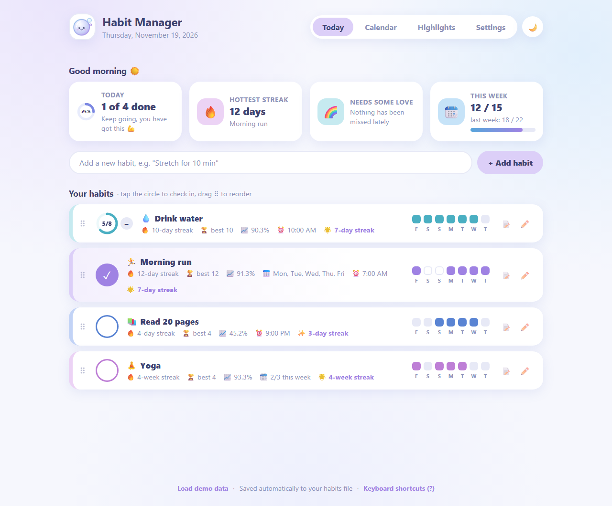
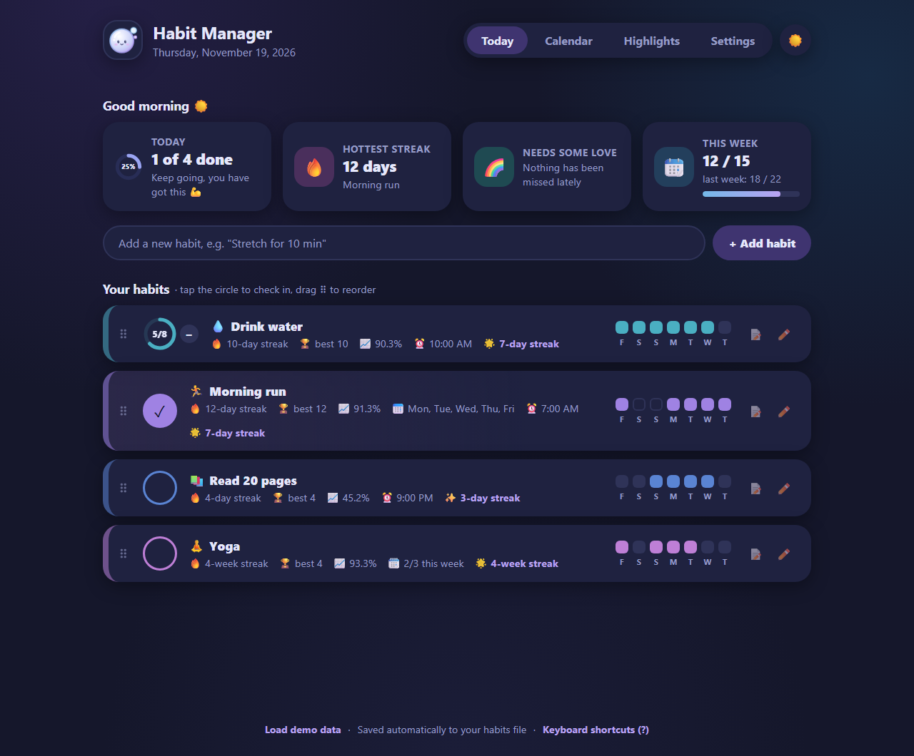
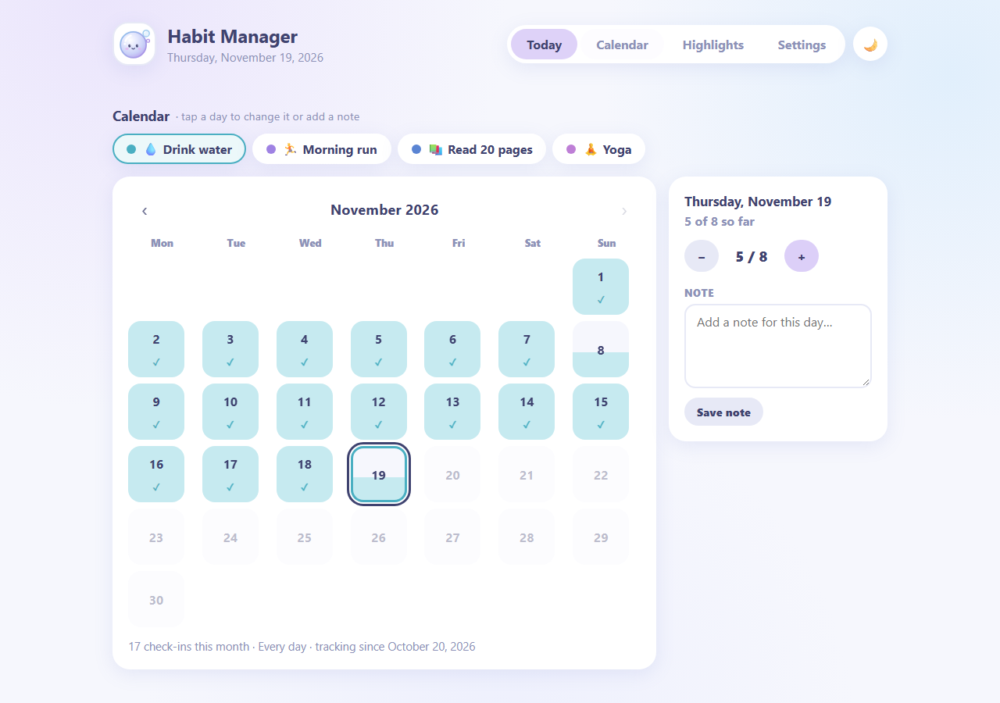
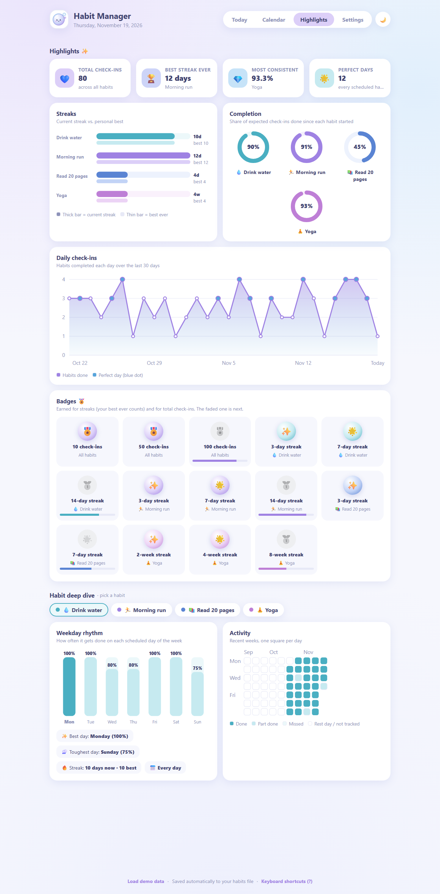
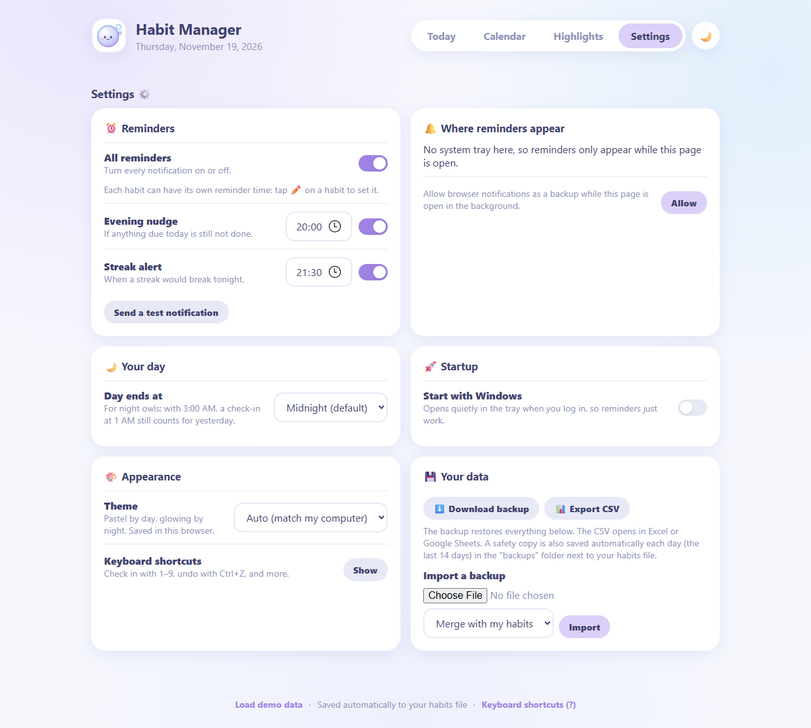

# Habit Manager 🫧

A cute, pastel habit tracker written in plain Core Java 17. It has no external libraries, no database and no frameworks.
Java runs a small web server on your own computer, and the dashboard opens in your browser.

Here's what it does:
- Track habits on your own schedule.
- Count towards daily targets and add notes.
- Get reminders as Windows notifications.
- Earn badges.
- See your streaks and patterns as graphs, in light or dark mode.



| Dark mode | Calendar |
|---|---|
|  |  |

<details>
<summary>More screenshots: Highlights and Settings</summary>




</details>

## Quick start (no Java needed)

1. Build the app once with `.\package.ps1` (see [Packaging](#packaging)), or get `HabitManager-windows.zip` from someone who did.
2. Unzip it anywhere and double-click **`HabitManager.exe`**.

The dashboard opens in your browser, and a bubble icon appears in the system tray. Your habits are saved in
`%APPDATA%\HabitManager`. Double-clicking the app again just reopens the dashboard.

## Run from source

You need JDK 17 or newer (`javac -version` should print 17+). Run these from the project folder, in PowerShell, cmd or bash.

Build:

```bash
javac -d out src/habitmanager/*.java src/habitmanager/model/*.java src/habitmanager/service/*.java src/habitmanager/storage/*.java src/habitmanager/settings/*.java src/habitmanager/reminders/*.java src/habitmanager/desktop/*.java src/habitmanager/ui/*.java src/habitmanager/web/*.java
```

Run:

```bash
java -cp out habitmanager.Main
```

The dashboard opens at <http://localhost:8080>. When run from source, data is kept in `habits.txt` and `settings.properties`
in the project folder. Use `javaw` instead of `java` to run it without a console window.

| Option | What it does |
|---|---|
| `--port 9000` | Use a different port if 8080 is busy |
| `--data myfile.txt` | Use a different data file (settings and backups are kept next to it) |
| `--no-browser` | Don't open the browser automatically |
| `--no-tray` | No tray icon or Windows notifications; reminders only show in the open dashboard |
| `--console` | The original text menu instead of the dashboard |

For the console version on Windows, run `chcp 65001` first so the ✔ / ✘ symbols show correctly.

**"java is not recognized"?** Java isn't on your PATH. Install a JDK (`winget install EclipseAdoptium.Temurin.17.JDK`,
then reopen the terminal), or add it for the current window:

- PowerShell: `$env:Path = "C:\path\to\jdk\bin;$env:Path"`
- cmd: `set PATH=C:\path\to\jdk\bin;%PATH%`

## Features

**Today**
- Progress ring, hottest streak, the habits that need some love, and a weekly summary ("12 / 15, best week yet!").
- One-click check-ins, or a 3/8 ring with + and − for habits with a daily target.
- The last 7 days as dots, plus chips for the schedule, reminder, best badge and today's note.
- Drag ⠿ (or focus it and use the arrow keys) to reorder.
- Archived habits sit in their own section, where you can restore or delete them.

**Calendar**
- A month view for each habit. Part-done days are half filled, rest days are striped, and days with notes have a dot.
- Tap a day to mark it done, adjust its count, or write a note.

**Highlights**: every graph is drawn by hand in SVG.
- Streak bars and completion donuts.
- Daily check-ins over 30 days (blue dots are perfect days).
- **Badges** for 3/7/14/30/50/100/200/365-day streaks (or 2–52 weeks) and for 10–1000 total check-ins.
  Earning one pops up a celebration with floating bubbles 🎉.
- A weekday rhythm chart and a GitHub-style activity heatmap.

**Settings**
- **Reminders:** a master switch, the evening nudge and the streak alert (with times), and a test notification.
- **Your day:** "Day ends at", for night owls.
- **Startup:** Start with Windows.
- **Appearance:** Auto, Light or Dark theme.
- **Your data:** download a backup or a CSV, or import a backup (merge or replace).

**Habits** can be:
- every day, some days (e.g. Mon/Wed/Fri), or X times a week
- given a daily target (e.g. 8 glasses)
- given an emoji, a colour and a reminder time
- archived instead of deleted

**Undo anything** with Ctrl+Z or the Undo button on each message. This includes deletes, imports and loading demo data
(up to 30 steps, until the app restarts).

### Keyboard shortcuts

| Keys | Action |
|---|---|
| `1` – `9` | Check in habit 1 to 9 (or add one towards its target) |
| `Ctrl` + `Z` | Undo the last change |
| `N` | New habit |
| `T` `C` `H` `S` | Today, Calendar, Highlights, Settings |
| `D` | Switch between light and dark |
| `?` | Show the shortcuts |

Each tab also has its own address (`#today`, `#calendar`, `#highlights`, `#settings`), so the back button and bookmarks work.

### Reminders

| Reminder | When |
|---|---|
| Habit reminder | At the habit's own time, if it's due today and not done yet |
| Evening nudge | At the nudge time (default 8:00 PM), if anything due today is still not done |
| Streak alert | At the alert time (default 9:30 PM), if a streak of 2+ days would break tonight |

- They pop up from the tray icon even when the browser is closed. Right-click the icon to open the dashboard, mark a
  habit done, snooze the last reminder, or quit.
- Each reminder is sent at most once a day.
- A reminder up to 2 hours late (computer was asleep) is still sent. Older ones are skipped.
- Snoozed reminders come back after 10 minutes.
- In the open dashboard, reminders also appear as banners with **Mark done** and **Snooze** buttons.

## Your data and backups

- **Download backup** (Settings) saves everything as one text file. **Import** restores it:
  - **Replace** swaps in the backup.
  - **Merge** adds new habits and fills in days from the backup.
- **Export CSV** gives one row per tracked day (habit, date, count, target, done, note) for Excel or Google Sheets.
- A **daily safety copy** is kept automatically in a `backups` folder next to your data file, for the last 14 days.
  To go back to one, import it with **Replace**.
- An old `habits.txt` (from the first version) can be imported too. It's also upgraded automatically, with the original
  kept as `habits.txt.v1.bak`.

Moving from the source version to the packaged app? Download a backup in one, and import it in the other.

## Packaging

`package.ps1` builds a double-clickable Windows app with jpackage (part of the JDK). The app carries its own small Java
runtime, so the computer you run it on doesn't need Java.

```bash
powershell -ExecutionPolicy Bypass -File .\package.ps1
```

This creates `dist\HabitManager\HabitManager.exe` (about 40 MB including Java) and `dist\HabitManager-windows.zip` to share.
Add `-Installer` to also build a classic setup `.exe` with Start-menu and desktop shortcuts. That needs the
[WiX Toolset 3](https://wixtoolset.org/docs/wix3/) on your PATH.

## Tests

```bash
javac -cp out -d out tests/StreakAndInsightTests.java tests/ScheduleAndReminderTests.java tests/DataAndBadgeTests.java
```

```bash
java -cp out StreakAndInsightTests
```

```bash
java -cp out ScheduleAndReminderTests
```

```bash
java -cp out DataAndBadgeTests
```

There are 265 checks in plain Java, with no JUnit. Each prints `PASS` or `FAIL` and a final count, and exits with status 1 if anything fails.

| Test class | Covers |
|---|---|
| `StreakAndInsightTests` | streaks (incl. month ends and leap years), completion %, weekday rates, storage |
| `ScheduleAndReminderTests` | schedules, targets, notes, the file format and its upgrade, settings, reminders, Start with Windows |
| `DataAndBadgeTests` | undo, import / merge, CSV, daily backups, badges, the weekly summary, file safety, the app icon |

## Project structure

```
Habit Manager/
├── src/habitmanager/
│   ├── Main.java                 # entry point: dashboard (default) or --console; packaged-app defaults
│   ├── model/                    # Habit, Schedule (every day / some days / X a week), CheckIn (count + note)
│   ├── service/
│   │   ├── HabitManager.java     # add / edit / delete / reorder / archive / check in / progress / notes
│   │   ├── HabitService.java     # saves every change, undo history, import/export, "day ends at", reminders
│   │   ├── StreakCalculator.java # schedule-aware current and longest streaks
│   │   ├── InsightEngine.java    # completion %, weekday rates, due today, summary, weekly summary
│   │   ├── Milestones.java       # badges
│   │   ├── DataExchange.java     # CSV export, merging backups
│   │   └── DemoDataGenerator.java
│   ├── storage/                  # habits.txt (format 2, reads format 1), daily backups
│   ├── settings/                 # settings.properties
│   ├── reminders/                # ReminderEngine (pure logic), scheduler, NotificationCenter
│   ├── desktop/                  # tray icon, Start with Windows, .ico export
│   ├── ui/ConsoleUI.java         # text menu (--console)
│   └── web/                      # JDK HTTP server (localhost only), JSON API, static files
├── web/                          # dashboard: index.html, styles.css, app.js, charts.js, bubble.svg
├── tests/                        # three plain-Java test classes
├── docs/screenshots/
├── package.ps1                   # builds HabitManager.exe
└── README.md
```

All the business rules stay in the Java classes. The browser only draws the numbers the server sends.

## API

The dashboard talks to the server through a small JSON API on localhost. Changes return the full, recalculated state.
POST requests must include the header `X-Habit-Client: 1`, which stops other websites from changing your data.

| Method | Path | Fields |
|---|---|---|
| GET | `/api/state` · `/api/settings` · `/api/notifications?after=ID` | |
| GET | `/api/export/csv` · `/api/export/backup` | (file downloads) |
| POST | `/api/habits/add` | `name` + details |
| POST | `/api/habits/update` | `name`, `newName` + details |
| POST | `/api/habits/rename` · `/delete` · `/archive` · `/move` | `name` (+ `newName` / `archived` / `index`) |
| POST | `/api/checkin` · `/api/undo` | `name` (check in / uncheck today) |
| POST | `/api/toggle` | `name`, `date` |
| POST | `/api/progress` | `name`, `delta`, optional `date` |
| POST | `/api/note` | `name`, `note`, optional `date` |
| POST | `/api/history/undo` | (undo the last change of any kind) |
| POST | `/api/import?mode=merge\|replace` | the backup file as the `text/plain` body |
| POST | `/api/demo` · `/api/settings` · `/api/notifications/snooze` · `/api/notifications/test` | |

Details:
- `schedule` (`DAILY` / `WEEKDAYS` / `WEEKLY`)
- `days` (`MON,WED,FRI`)
- `timesPerWeek`
- `target`
- `reminder` (`HH:mm`)
- `color` (0–5)
- `emoji`

Dates are `yyyy-MM-dd`.

## How things are calculated

- **Current streak** counts backwards from today. If today isn't done yet, it starts from the previous day, so an
  unbroken streak doesn't drop to 0 before you've checked in.
  - *Some days* habits skip their rest days.
  - *X times a week* habits count weeks (Mon–Sun) that met the goal.
- **Longest streak** is the longest such run ever. Badges use it, so they're never lost.
- **Completion %** is done / expected × 100, rounded to 1 decimal. Today is included.
  - Every day: days since creation.
  - Some days: scheduled days only.
  - X times a week: the weekly goal, capped by the days that week the habit existed.
- **Daily targets**: a day is done when its count reaches the target. Raising a target keeps past days done.
- **Weekday rates**: completions on a weekday ÷ how often that weekday has occurred. Rest days and weekdays that haven't come round yet are left out.
- **Due today** decides what counts in "x of y done today":
  - every daily habit
  - *some days* habits on their days
  - *X times a week* habits until the week's goal is met
- **This week** is check-ins Monday–today against what was expected so far (the same rules as completion %).
  "Best week yet" means more check-ins than any earlier week.
- **Needs attention**:
  - Every day: missed today and the 2 days before.
  - Some days: the last 3 scheduled days missed.
  - X times a week: nothing in 7 days.
  - New habits aren't flagged.
- **Day ends at** (midnight to 5 AM) shifts what "today" means. With 3:00 AM, a 1 AM check-in counts for the day before.

## Data files

`habits.txt` uses format 2: a header, then one habit per line as `key=value` fields with URL-encoded text.

```
# habitmanager format 2
name=Drink+water|created=2024-03-01|schedule=DAILY|target=8|reminder=10:00|color=4|emoji=%F0%9F%92%A7|archived=false|checkins=2024-03-01:8,2024-03-02:3:with+lemon
```

Each check-in is `date:count` or `date:count:note`. Unknown keys are ignored, and a malformed line is skipped with a
warning that shows its line number.

`settings.properties` holds the Settings tab values. A missing or broken value falls back to the default.
